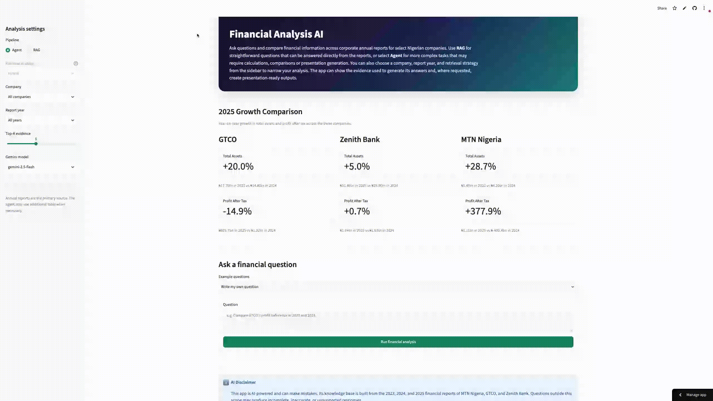
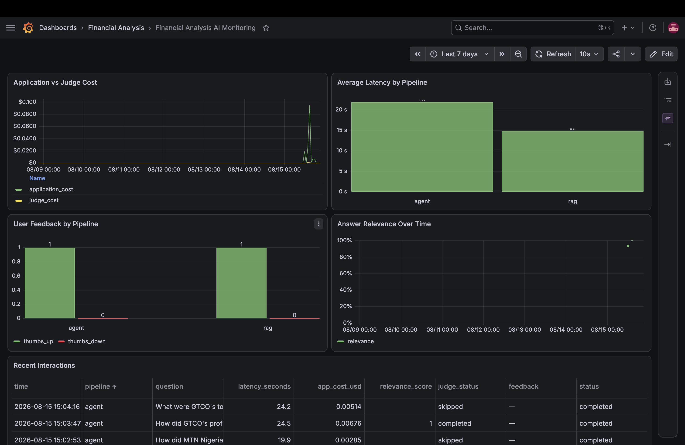

# FinTech Analysis AI Platform

An enterprise-grade AI financial intelligence system for exploring, analyzing, and interrogating annual reports and statutory filings of leading Indian banking and fintech companies (**HDFC Bank, ICICI Bank, Paytm**) using Hybrid RAG and Autonomous Agentic workflows.


---



## Table of Contents

1. [Project Overview](#project-overview)
2. [Problem Statement](#problem-statement)
3. [Key Capabilities](#key-capabilities)
4. [System Architecture](#system-architecture)
5. [Technology Stack](#technology-stack)
6. [Agentic Tools & Source Prioritization](#agentic-tools--source-prioritization)
7. [Observability & Monitoring](#observability--monitoring)
8. [Getting Started](#getting-started)
9. [Project Structure](#project-structure)

---

## Project Overview

Corporate annual reports and Ind AS financial statements often exceed 300+ pages of dense narrative notes, balance sheets, and regulatory filings. Making sense of these numbers, performing multi-year financial comparisons, and verifying compliance metrics requires extensive manual extraction and analysis.

**FinTech Analysis AI Platform** automates and elevates this workflow. It provides:
- **Evidence-Grounded Answers:** Plain-language question answering backed by **page-level citations** to eliminate guesswork.
- **Structured Table Understanding:** Parsing and targeted querying of balance sheets, income statements, and cash flows.
- **Zero-Hallucination Arithmetic:** Execution of all financial ratios and multi-year calculations through a deterministic execution engine.
- **Multi-Tool Autonomous Agent:** Dynamic tool orchestration to search keyword indexes, vector spaces, structured tables, or generate presentation decks.

The current dataset indexes statutory annual reports for leading financial and fintech leaders on the **National Stock Exchange (NSE)** and **Bombay Stock Exchange (BSE)**:
- **HDFC Bank Limited (`HDFCBANK`)**
- **ICICI Bank Limited (`ICICIBANK`)**
- **One97 Communications Limited / Paytm (`PAYTM`)**

---

## Problem Statement

Evaluating companies and conducting credit or equity research faces three primary challenges:
1. **Information Density:** Sifting through hundreds of pages for specific footnotes or management commentary is inefficient.
2. **LLM Hallucinations in Finance:** Standard LLMs frequently invent financial figures or commit basic arithmetic errors when performing percentage changes or margin calculations.
3. **Structured vs. Unstructured Data:** Annual reports combine prose (MD&A) with complex multi-column financial tables, which standard naive chunking splits and destroys.

This platform bridges this gap by decoupling lexical search, dense vector retrieval, and deterministic math execution into a unified, observable pipeline.

---

## Key Capabilities

### 1. Dual Execution Modes
- **Standard RAG Pipeline:** Ideal for factual queries directly addressable from company filings with page-level citations.
- **Autonomous Agent Pipeline:** Dynamically selects tools to answer multi-part questions, cross-company comparisons, and analytical queries.

### 2. High-Precision Hybrid Retrieval
Combines **PostgreSQL Full-Text Search (BM25/Lexical)** with **pgvector Dense Embeddings (`all-MiniLM-L6-v2`)** fused via **Reciprocal Rank Fusion (RRF)** to balance exact financial keyword matching with semantic intent.

### 3. Financial Table Extraction & Lookup
Extracts tabular sections as first-class citizens using PyMuPDF and stores them in structured schemas for row/column inspection.

### 4. Deterministic Calculator
When computing growth rates, Net Interest Margins (NIM), or Year-on-Year differences, the Agent delegates calculations to a secure Python execution engine instead of relying on LLM internal math.

### 5. Automated Presentation Generation
Can generate and export PowerPoint (`.pptx`) decks summarizing comparative findings with executive bullets, KPI metric cards, and cited sources.

---

## System Architecture

```
                                [ Annual Report Filings (PDFs) ]
                                               │
                                   (PyMuPDF / Table Extraction)
                                               ▼
                             [ Ingestion & Document Processing ]
                                               │
                                             (dlt)
                                               ▼
                              [ PostgreSQL + pgvector Database ]
                                ├── Full-Text Search (Lexical)
                                ├── Vector Store (Embeddings)
                                └── Structured Report Tables
                                               │
                                    (Hybrid Search: RRF)
                                               │
               ┌───────────────────────────────┴───────────────────────────────┐
               ▼                                                               ▼
       [ Standard RAG ]                                             [ Autonomous Agent ]
   (Gemini + Grounded Context)                                ├── Keyword / Semantic Search
               │                                              ├── Table Lookup
               │                                              ├── Deterministic Calculator
               │                                              └── PPTX Deck Generator
               └───────────────────────────────┬───────────────────────────────┘
                                               │
                                       [ FastAPI API ]
                                               │
                                 [ Streamlit Web Interface ]
                                               │
                                   [ Grafana Telemetry ]
```

---

## Technology Stack

| Layer | Technologies | Role in System |
|---|---|---|
| **Core Language** | Python 3.11+ | Core application and orchestration logic |
| **Package Management** | `uv` | High-performance dependency and virtual environment management |
| **Database & Vector Store** | PostgreSQL 17+, `pgvector` | Hybrid lexical search, embeddings storage, and table persistence |
| **Embeddings** | SentenceTransformers (`all-MiniLM-L6-v2`) | Dense representation for semantic search |
| **LLM & Reasoning** | Google Gemini API | Natural language understanding, synthesis, and tool calling |
| **Backend API** | FastAPI, Uvicorn | REST API powering search, RAG, and agent execution |
| **Frontend UI** | Streamlit | Interactive user interface with citations and feedback loop |
| **Document Processing** | PyMuPDF | Text extraction, layout parsing, and table isolation |
| **Observability** | Grafana, PostgreSQL | Real-time monitoring of latency, token usage, costs, and relevance |
| **Containerization** | Docker, Docker Compose | Reproducible environment for database and monitoring services |

---

## Agentic Tools & Source Prioritization

For complex questions, the autonomous agent prioritizes sources in a structured hierarchy:
1. **Verified Statutory Annual Reports** (Text narrative & notes)
2. **Extracted Financial Tables** (Balance Sheet, P&L, Cash Flow)
3. **Deterministic Python Execution** (Arithmetic & growth calculations)
4. **Public Web Verification** (External context if explicitly requested)

| Agent Tool | Description |
|---|---|
| `search_keyword` | Lexical search for exact financial terms, accounting lines, and names. |
| `search_semantic` | Meaning-based dense retrieval via vector similarity. |
| `search_hybrid` | Reciprocal Rank Fusion of keyword and semantic candidates. |
| `lookup_table` | Inspects rows, columns, and values within extracted financial tables. |
| `calculate` | Executes deterministic Python calculations to avoid mathematical hallucination. |
| `generate_presentation` | Compiles analysis into structured PowerPoint (`.pptx`) slides. |

---

## Observability & Monitoring

The system includes a complete LLMOps monitoring layer. Telemetry is tracked in PostgreSQL and visualised through Grafana:
- **Cost & Token Tracking:** Input/output token metrics and estimated inference spend per call.
- **Latency & Performance:** End-to-end response times across retrieval, generation, and agent tool execution.
- **Answer Relevance:** Evaluation metrics assessing grounding against retrieved sources.
- **User Feedback:** Thumbs-up/down ratings recorded per session to gauge answer quality.

### Performance & Cost Dashboard


### Telemetry & Interaction Monitoring


---

## Getting Started

### 1. Prerequisites
- Python 3.11+
- `uv` package manager
- Docker & Docker Compose
- Google Gemini API Key

### 2. Environment Setup
```bash
# Clone the repository
git clone https://github.com/Varun-bale8/Fintech_Analysis-AI-Platform.git
cd Fintech_Analysis-AI-Platform

# Configure environment variables
cp .env.example .env
```

Edit `.env` with your database credentials and Gemini API key:
```env
GEMINI_API_KEY=your_gemini_api_key
POSTGRES_HOST=localhost
POSTGRES_PORT=5432
POSTGRES_DB=financial_analysis
POSTGRES_USER=financial_user
POSTGRES_PASSWORD=your_password
```

### 3. Launch Infrastructure & Run Ingestion
```bash
# Start PostgreSQL with pgvector
docker compose up -d db

# Install dependencies with uv
uv sync --all-groups

# Ingest and index reports
uv run python -m ingestion.download_annual_reports
uv run python -m ingestion.pipelines.ingest_reports
uv run python -m retrieval.index
```

### 4. Start the Application
```bash
# Terminal 1: Start FastAPI Backend
uv run uvicorn deployment.backend.main:app --host 0.0.0.0 --port 8000 --reload

# Terminal 2: Start Streamlit Frontend
uv run streamlit run deployment/frontend/app.py
```

---

## Project Structure

```
├── agent/                  # Multi-tool agent pipeline, prompts, and tool implementations
│   ├── tools/              # Calculator, retrieval, table lookup, PPTX generators
├── data/                   # Report PDFs, extracted metadata, and frontend snapshots
├── deployment/             # Deployment configurations
│   ├── backend/            # FastAPI REST endpoints and database layer
│   └── frontend/           # Streamlit application
├── evaluation/             # Retrieval and answer quality evaluation pipeline
├── ingestion/              # PDF processing, chunking, and table extraction pipelines
├── media/                  # Architecture diagrams and dashboard screenshots
├── monitoring/             # Telemetry, pricing calculator, and Grafana provisioning
├── rag/                    # Standard RAG generation and prompt pipelines
├── retrieval/              # Hybrid search, vector search, and keyword indexing
├── scripts/                # Utility scripts for benchmarks and snapshot generation
└── tests/                  # Smoke and integration test suites
```
